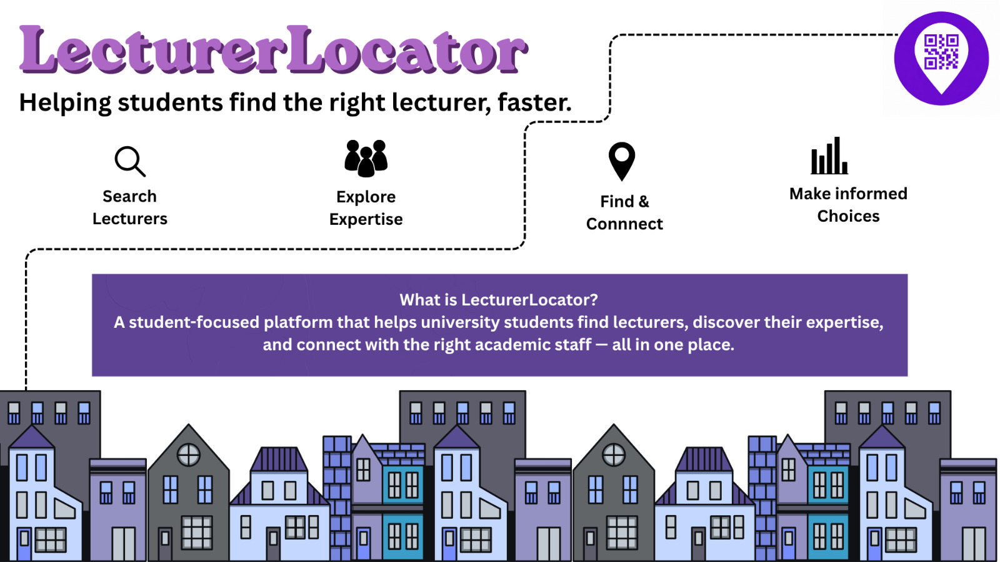

# LecturerLocator

Find lecturers, explore their expertise, and get directions to their offices. Search the directory or scan a lecturer’s QR code to open their profile, contact details, office hours, timetable, and predefined office route.

## Features

- **Lecturer directory:** search by name and view academic details, modules, and research areas.
- **Profiles and directions:** view contact details, profile photos, office hours, timetables, and route overlays on floor plans.
- **QR codes:** scan a lecturer’s code or download a printable QR-code PDF from lecturer management.
- **Administration:** manage lecturers, buildings, floor plans, offices, and routes after signing in.
- **Built-in route editor:** draw and save office routes directly in the app.
- **Installable web app:** install on supported browsers and devices. Camera scanning requires camera permission and a secure connection (HTTPS or localhost).

## Tech Stack

- **Frontend:** React, TypeScript, Vite, and Tailwind CSS
- **Backend:** Node.js, Express, and TypeScript
- **Database:** PostgreSQL with Drizzle ORM
- **Authentication:** Better Auth

The frontend and backend communicate through a REST API. Routes are drawn by administrators and displayed as SVG overlays; the backend does not calculate walking paths automatically.

## Project Structure

```text
lecturer-locator/
├── frontend/
│   └── src/                  # React pages, including the built-in RouteEditor
├── backend/
│   ├── src/
│   │   ├── routes/           # API endpoints
│   │   ├── controllers/      # Request handlers
│   │   ├── db/               # Database schema and access
│   │   ├── data/             # Bundled floor plans and route SVGs
│   │   ├── app.ts            # Express app and middleware
│   │   └── server.ts         # Local server entry point
│   ├── scripts/              # Setup, administrator provisioning, and seed data
│   ├── drizzle/              # Database migrations
│   └── test/                 # Backend tests
├── docs/                     # API, architecture, requirements, and images
├── tools/route-editor/       # Legacy standalone editor; superseded by the app
├── docker-compose.yml        # Local PostgreSQL database
└── vercel.json               # Deployment configuration
```

## Prerequisites

- **Node.js 24+** and npm. The backend runs TypeScript files directly with Node.js.
- **Git**
- **Docker Desktop** or Docker Engine with Compose, for the local database

## Running Locally

Run these commands from the repository root unless a different directory is shown.

### 1. Start the database

```bash
docker compose up -d
```

### 2. Set up the backend

```bash
cd backend
npm install
npm run setup
```

Setup creates `backend/.env` with a generated authentication secret and the local database connection if the file does not exist, then applies migrations. It leaves an existing `.env` unchanged. If you already have one, check its values against [backend/.env.example](backend/.env.example).

To load fictional development data, run this optional command from `backend/`:

```bash
npm run seed
```

Seeding inserts missing sample records and refreshes matching sample lecturers, office hours, office assignments, module links, floor-plan references, and route SVGs. It preserves lecturer IDs and unrelated records, but overwrites manual edits to matching sample data. Seeding is separate from setup and is disabled when `NODE_ENV=production`.

### 3. Create an administrator

To use lecturer management and the route editor, add these values to `backend/.env`:

```dotenv
ADMIN_EMAIL=your-admin-email
ADMIN_PASSWORD=your-chosen-password
ADMIN_NAME=Your name
```

Use your own credentials and a password of at least eight characters. Then, from `backend/`, run:

```bash
npm run create-admin
```

Setup also provisions an administrator if these values are already configured. There is no public sign-up page.

### 4. Start the backend

From `backend/`:

```bash
npm run dev
```

The backend runs at [http://localhost:3000](http://localhost:3000).

### 5. Start the frontend

In a separate terminal, from the repository root:

```bash
cd frontend
npm install
npm run dev
```

Open [http://localhost:5173](http://localhost:5173). Vite forwards API and floor-plan requests to the local backend. Both servers must be running to use the app with data.

## Managing Floor Plans and Routes

The route editor is part of the main app. **The standalone Footpath tool and its GitHub Pages deployment are no longer used in the application workflow.**

1. Sign in and open **Admin menu → Buildings**.
2. Under **Floor Plans**, upload an SVG for the building and floor.
3. Under **Offices**, add offices linked to that floor plan.
4. Under **Routes**, select an office and choose **Create route in editor**.
5. Enter the entrance name. The office’s floor plan loads automatically.
6. Draw the route from the entrance through each corridor turn, then place the office pin. Use zoom, pan, undo, and draggable points to adjust it.
7. Choose footprints or arrows, adjust their size and colour, and select **Save route**.

The app uploads the SVG overlay and saves its reference against the office’s route. Saved routes appear on lecturer profiles under directions. To update one, choose **Edit** in the Routes list. Older overlays without editable drawing metadata may need to be redrawn.

The original files remain in [tools/route-editor](tools/route-editor/README.md) for historical reference; they are not required to run the app. No separate export or GitHub Pages deployment is needed.

## Development Checks

From `frontend/`:

```bash
npm run build
npm run lint
```

From `backend/`:

```bash
npm run typecheck
npm test
```

## Documentation

- [API reference](docs/api.md)
- [Architecture and map approach](docs/architecture.md)
- [Project requirements](docs/requirements.md)

## Development Approach

Keep the code simple and easy to understand:

- Avoid unnecessary libraries and complexity.
- Keep API routes small and put request handling in controllers.
- Keep route editing and display logic separate from data access.
- Discuss new technologies or major dependencies before introducing them.
