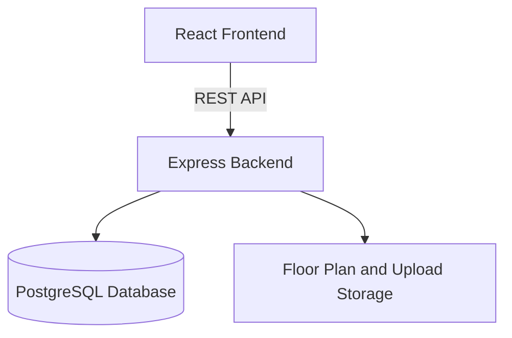

# Architecture

## Map Approach

Each floor has an SVG floor plan, and each office may have a predefined route displayed as an SVG overlay on that floor plan. Routes are drawn by administrators rather than calculated automatically.

The route editor is a protected page in the React app, reached through **Admin menu → Buildings → Routes**. It loads an office’s floor plan, creates an SVG containing route symbols, a destination pin, and editable drawing metadata, then uploads it through the backend. The route record stores the office, entrance name, and SVG overlay reference. The viewer also supports existing inline SVG overlays.

The standalone editor in `tools/route-editor/` is legacy reference material and is not part of this workflow.

## File Storage

Bundled floor plans and route assets are kept in `backend/src/data/floorplans/`. In local development, uploaded floor plans and route overlays are stored there too; profile photos and timetables are stored under `backend/data/uploads/`.

In production, uploads use S3-compatible object storage configured through the `STORAGE_S3_*` environment variables. The frontend accesses uploaded files through the backend’s `/api/files/` endpoints.

See the [API reference](api.md) for endpoints and the [main README](../README.md) for local setup.
