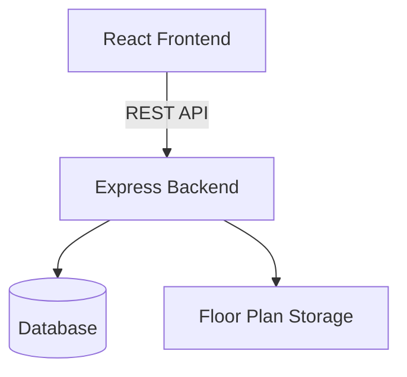

## Map Approach

Each floor has a floor-plan image.

Each office may have a route that is displayed as an SVG overlay
on top of the floor plan. Route data will be stored in the database

This architecture is provisional and may change after requirements are finalised.